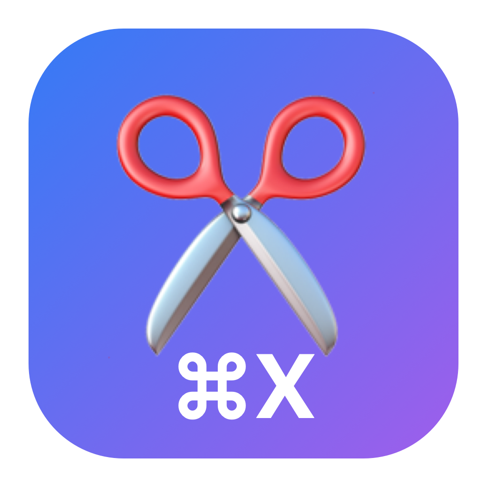
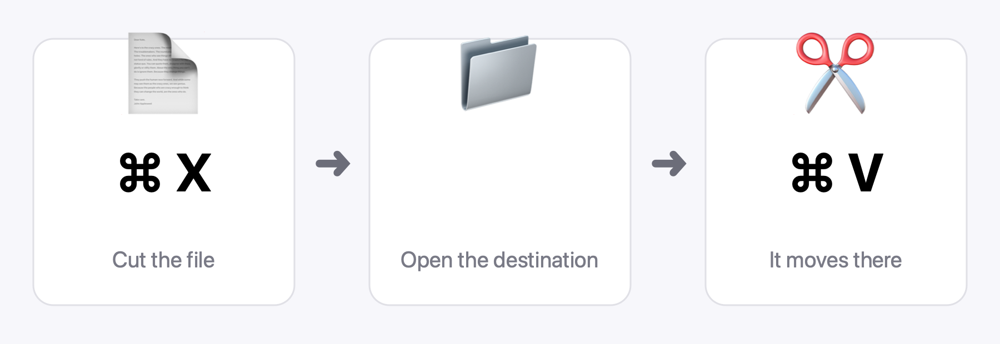

<p align="center">
  🌐 <a href="README.md">English</a> · <a href="README.es.md">Español</a> · <strong>中文</strong>
</p>

<p align="center">
  
</p>

<h1 align="center">FinderCut</h1>

<p align="center"><strong>By AbadXDev</strong></p>

<p align="center">
  在 <strong>Finder</strong> 中使用 <strong>⌘X</strong> 和 <strong>⌘V</strong> 剪切和粘贴文件 — 免费且开源。<br>
  这是 macOS 从未给 Finder 的剪切命令。
</p>

<p align="center">
  
  
  
  <a href="https://github.com/AbadXDev/findercut/releases/latest"></a>
</p>

## 下载

| 系统 | 下载 | 说明 |
| --- | --- | --- |
| **macOS** 13+（Apple silicon 和 Intel） | [最新版本](https://github.com/AbadXDev/findercut/releases/latest) → `FinderCut-v1.0.0.zip` | 解压后将 `FinderCut.app` 移到“应用程序”文件夹。临时签名（未公证）：如果首次运行时被 macOS 阻止，请右键点击该应用并选择**打开**。然后在 macOS 询问时授予**辅助功能**权限 — FinderCut 需要它来监听 Finder 中的 ⌘X。 |

无需编译 — 直接从 [Releases](https://github.com/AbadXDev/findercut/releases) 页面下载应用即可使用。

## 工作原理

<p align="center">
  
</p>

1. 在 Finder 中**选择文件**并按 **`⌘X`** — FinderCut 会复制这些文件并记住有一次剪切正在等待。菜单栏中的剪刀图标会显示待处理的剪切。
2. **打开目标文件夹**并按 **`⌘V`** — FinderCut 会将这次粘贴变成 Finder 原生的**将项目移到这里**（`⌥⌘V`），文件随即移动到那里。
3. **改变主意了？** 文件还没有移动 — 剪切只在粘贴时才真正发生。按 `Esc`、用 `⌘C` 复制其他内容，或者干脆不要粘贴即可。

## 键盘快捷键

| 按键 | 作用 |
| --- | --- |
| `⌘X` | 剪切所选文件（标记为要移动） |
| `⌘V` | 将剪切的文件移到当前文件夹 — 如果没有待处理的剪切，则为普通粘贴 |
| `⌘C` | 照常复制（并取消任何待处理的剪切） |
| `Esc` | 取消待处理的剪切 |

## FinderCut 与付费替代品对比

|  | **FinderCut** | Command X |
| --- | --- | --- |
| 价格 | **免费** | $4 |
| 最低 macOS 版本 | **13** | 26 |
| 源代码 | **开源 (MIT)** | 闭源 |
| Apple silicon 和 Intel | ✅ 通用二进制 | — |

## 它刻意不会破坏的东西

- **重命名文件：** 当 Finder 正在编辑文件名时，`⌘X` / `⌘V` 仍然像往常一样剪切和粘贴*文本*。
- **其他应用：** 在 Finder 之外，FinderCut 什么都不做。
- **你的文件：** 在你粘贴之前，任何文件都不会被移动、重命名或删除。

## 系统要求

- macOS 13 或更高版本，Apple silicon 或 Intel 均可。
- **辅助功能**权限（系统设置 → 隐私与安全性 → 辅助功能）。在授予之前，剪刀菜单会显示“缺少辅助功能权限”；授予后 FinderCut 会自动生效，无需重新启动。

## 隐私

FinderCut 不收集任何数据，不连接任何服务器，也没有分析统计。它只在 Finder 位于前台时监听按键，且只监听 `⌘X`、`⌘V`、`⌘C` 和 `Esc`。

## 从源代码构建

需要在 macOS 13+ 上安装 Xcode 命令行工具：

```sh
git clone https://github.com/AbadXDev/findercut.git
cd findercut
./build.sh        # 生成 FinderCut.app（通用二进制，临时签名）
```

## 制作与许可

- 应用由 **AbadXDev** 制作 — MIT 许可证（见 `LICENSE`）。
- 与 Apple 无关。Finder 和 macOS 是 Apple Inc. 的商标。
